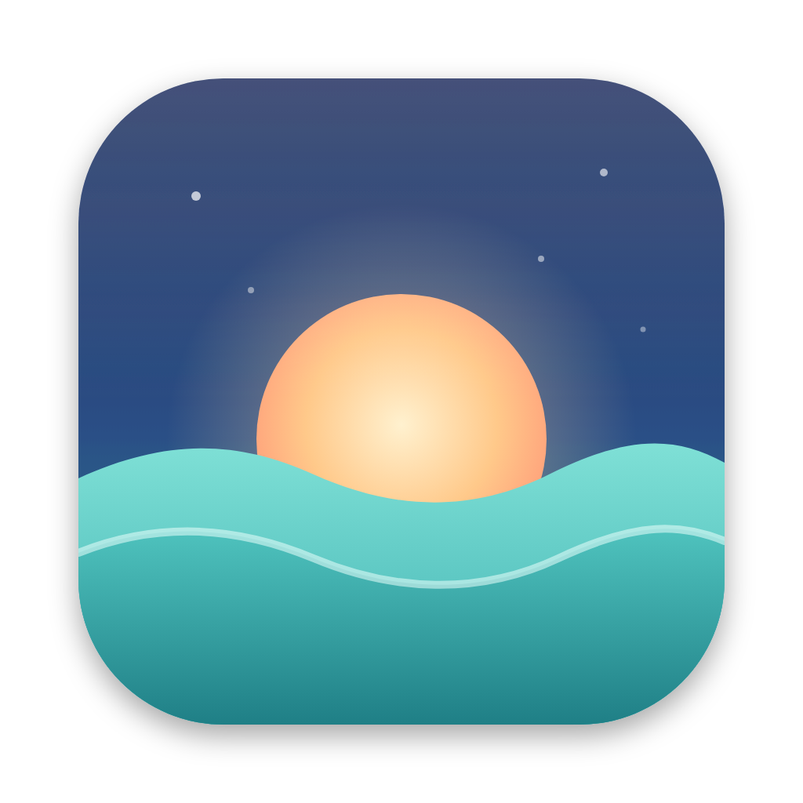
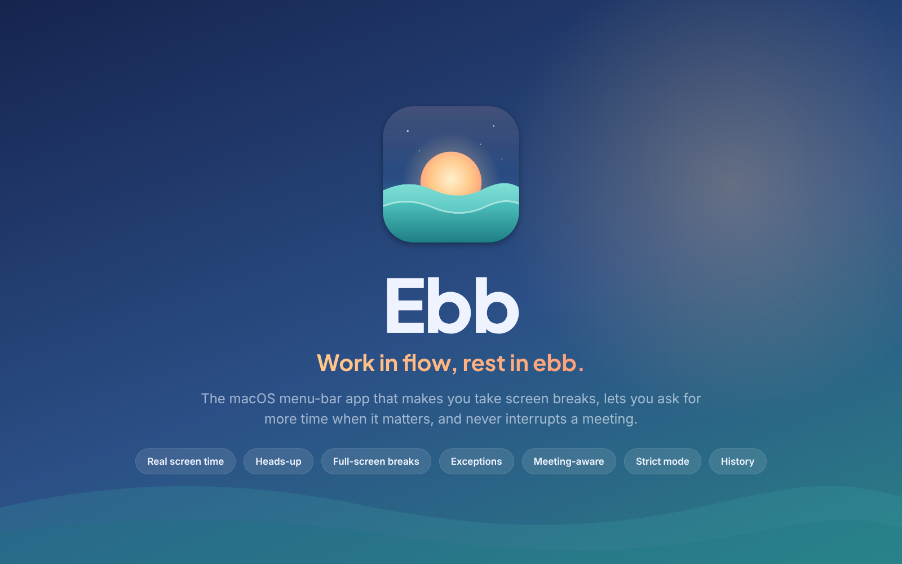
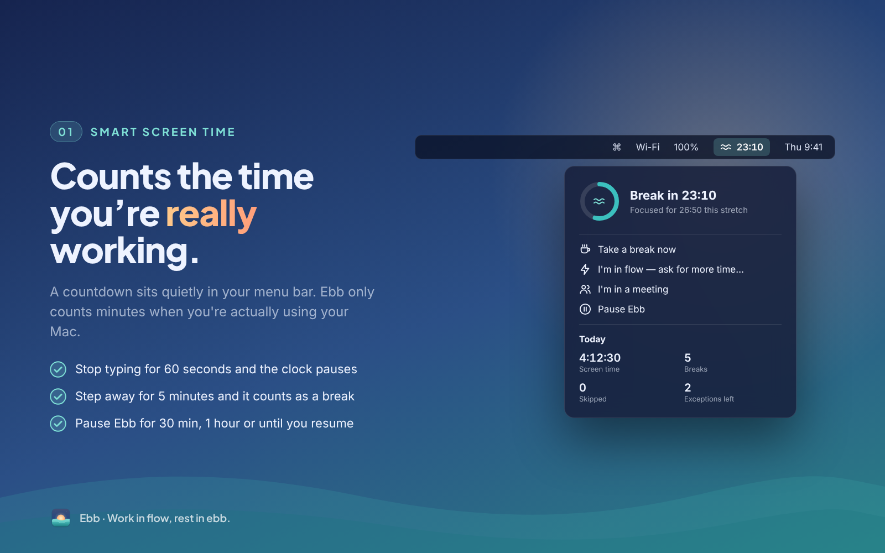
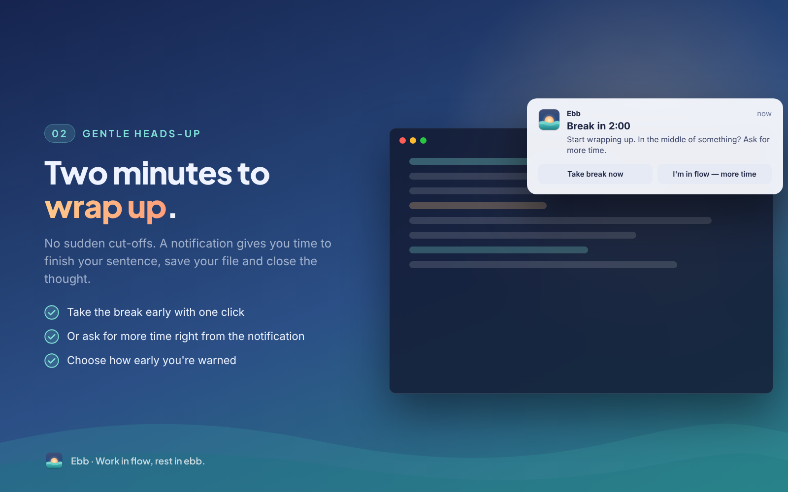
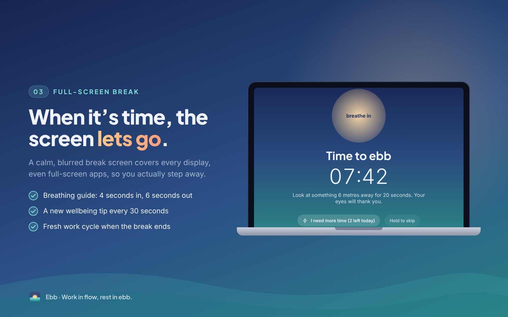
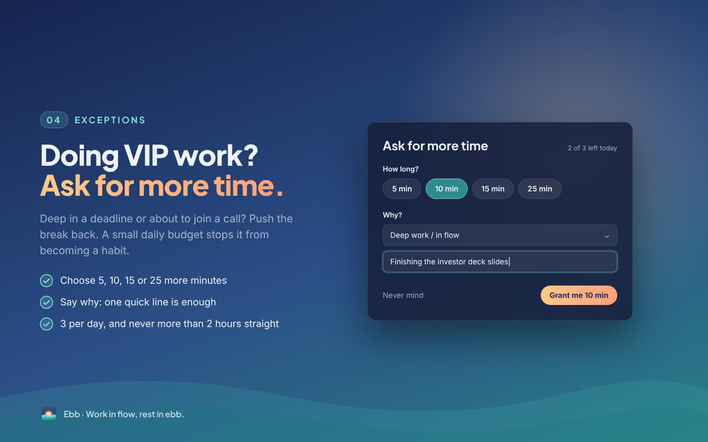
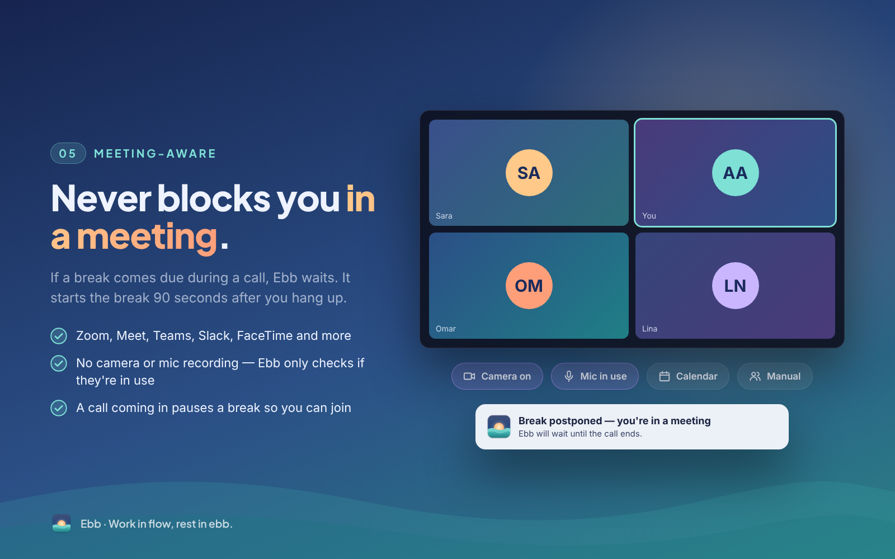
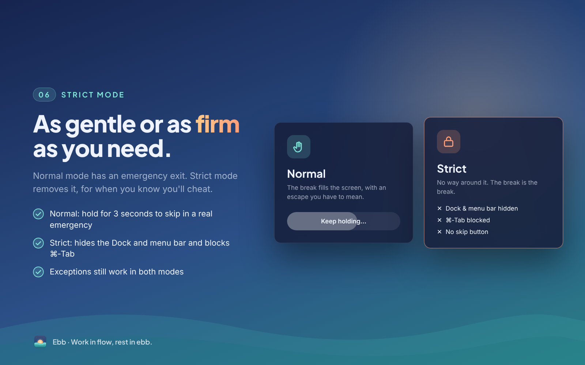
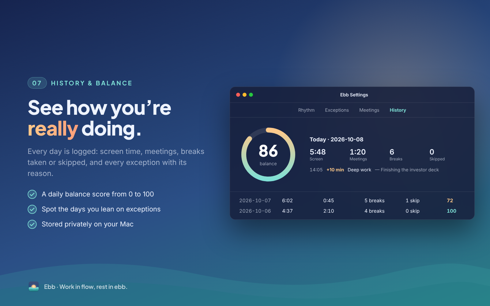

<p align="center"></p>

<h1 align="center">Ebb</h1>
<p align="center"><b>Work in flow, rest in ebb.</b><br>
A menu-bar / system-tray app for <b>macOS, Windows and Linux</b> that makes you take screen breaks, looks after your eyes, lets you ask for more time when it matters, and never interrupts a meeting.</p>

---

## What it does











### New in 0.2

* **Windows and Linux**, alongside macOS: one app, built with [Tauri](https://tauri.app).
* **Updates itself.** New versions download in the background and install the next time you step away (or when you click *Restart now*).
* **Counts screen time even when you're not touching anything.** Watching a video, a build, or a long job still counts:
  * A playing video (anything keeping the display awake: YouTube, Netflix, VLC…) always counts.
  * With no input at all, Ebb keeps counting for a grace period you choose (15 min by default). If it turns out you'd left, that time is taken back off.
  * Locking the screen, the screensaver, or the display sleeping counts as away straight away.
* **20-20-20 eye breaks**: every 20 minutes, a small card asks you to look 6 m (20 ft) away for 20 seconds.
* **Nudges** to blink, sit up straight, drink water and stretch, each on its own timer.
* **Daily screen-time limit** with a heads-up at 90%, and a **night wind-down** that warms and dims the screen.
* **Wellness score** (0–100) every day, a **weekly report** with trends and plain-language suggestions, and an optional one-tap **mood check-in** on breaks.

Full design and state machine: **[docs/PRODUCT.md](docs/PRODUCT.md)**. How it is tested: **[docs/TESTING.md](docs/TESTING.md)**.

## Install (no coding needed)

Download the file for your computer from the [latest release](../../releases/latest):

| System | File | Notes |
|---|---|---|
| **macOS** 14+ (Apple Silicon & Intel) | `Ebb_x.y.z_universal.dmg` | Open it, drag **Ebb** to Applications. The first time, macOS blocks it because the developer isn't verified: go to **System Settings → Privacy & Security** and click **Open Anyway**. |
| **Windows** 10/11 | `Ebb_x.y.z_x64-setup.exe` | If SmartScreen warns, click **More info → Run anyway**. |
| **Linux** | `Ebb_x.y.z_amd64.AppImage` (updates itself), or `.deb` / `.rpm` | AppImage: `chmod +x` it and run it. The tray icon needs AppIndicator support (on GNOME, the *AppIndicator* extension). |

After that, Ebb keeps itself up to date. (Users of the original 0.1 Mac app: install this once by hand; your history comes with you.)

## Publishing a new version

On GitHub, open **Actions → Build → Run workflow**, type a version such as `0.3.0`, and click **Run workflow**.
(Or push a tag: `git tag v0.3.0 && git push origin v0.3.0`.)
GitHub Actions tests the code on all three systems, builds the installers, and publishes a release with them and a signed `latest.json`. Every installed copy of Ebb picks the update up within a few hours.

**One-time setup:** updates are signed so that nobody else can push one to your users. Add the private key to the repository as a secret named `TAURI_SIGNING_PRIVATE_KEY` (Settings → Secrets and variables → Actions); it lives in `~/.tauri/ebb.key` on the computer that generated it. Keep a backup: if it's lost, existing installs can't verify new updates. The matching public key is in `src-tauri/tauri.conf.json`.

## Build & run from source

Needs [Rust](https://rustup.rs) and Node 20+. On Linux also: `libwebkit2gtk-4.1-dev libayatana-appindicator3-dev librsvg2-dev`.

```bash
git clone https://github.com/abdullah-abdullatif/ebb.git
cd ebb
npm install
make test      # the clock, eye breaks, nudges, scores, reports and storage
make dev       # run Ebb from source
make build     # installers for this OS in src-tauri/target/release/bundle/
```

Ebb lives in the menu bar (macOS) or system tray (Windows, Linux), with no Dock or taskbar icon. Click it for the panel; right-click for the menu.

### Permissions

| Feature | Permission |
|---|---|
| Idle, lock-screen and video detection | none |
| Camera / mic "in use" detection | none: Ebb asks the system whether a device is in use and never opens it |
| Calendar meetings (macOS, opt-in) | Calendar access, asked when you enable it |

**How "in use" is detected:** macOS: CoreMediaIO / CoreAudio and power assertions. Windows: the privacy usage records behind the taskbar's camera/mic indicator, and display-required power requests. Linux: GNOME/KDE over D-Bus (falling back to X11) for idle and lock, open `/dev/video*` devices, `pactl` for the microphone, and screensaver inhibitors / MPRIS for video. On Wayland desktops other than GNOME and KDE, idle time can't be read, so natural breaks are only detected when you lock the screen.

### Quick test settings

To see a break quickly, open **Settings → Rhythm**, set *Work* to 2 min and *Break* to 1 min, or click **Take a break now**.

## Project layout

```
src-tauri/src/
  clock.rs       SessionClock: the pure work/break state machine (most of the tests)
  wellness.rs    20-20-20 eye breaks and nudges, also pure
  stats.rs       Daily history, wellness score, weekly report and tips
  prefs.rs       Settings (prefs.json)
  engine.rs      1 Hz loop: reads the OS → clock → windows, toasts and stats
  platform/      macos.rs, windows.rs, linux.rs: idle, lock, video, camera, mic, calendar
  ui.rs          Break screen on every monitor, toasts, eye-break card, night dimming
  updater.rs     Background updates from GitHub Releases
  lib.rs         Tray, commands, startup
ui/              The windows: panel, settings (+ report), break, request, toast, eye, dim
scripts/         smoke-test.sh (runs the real app through a cycle)
```
